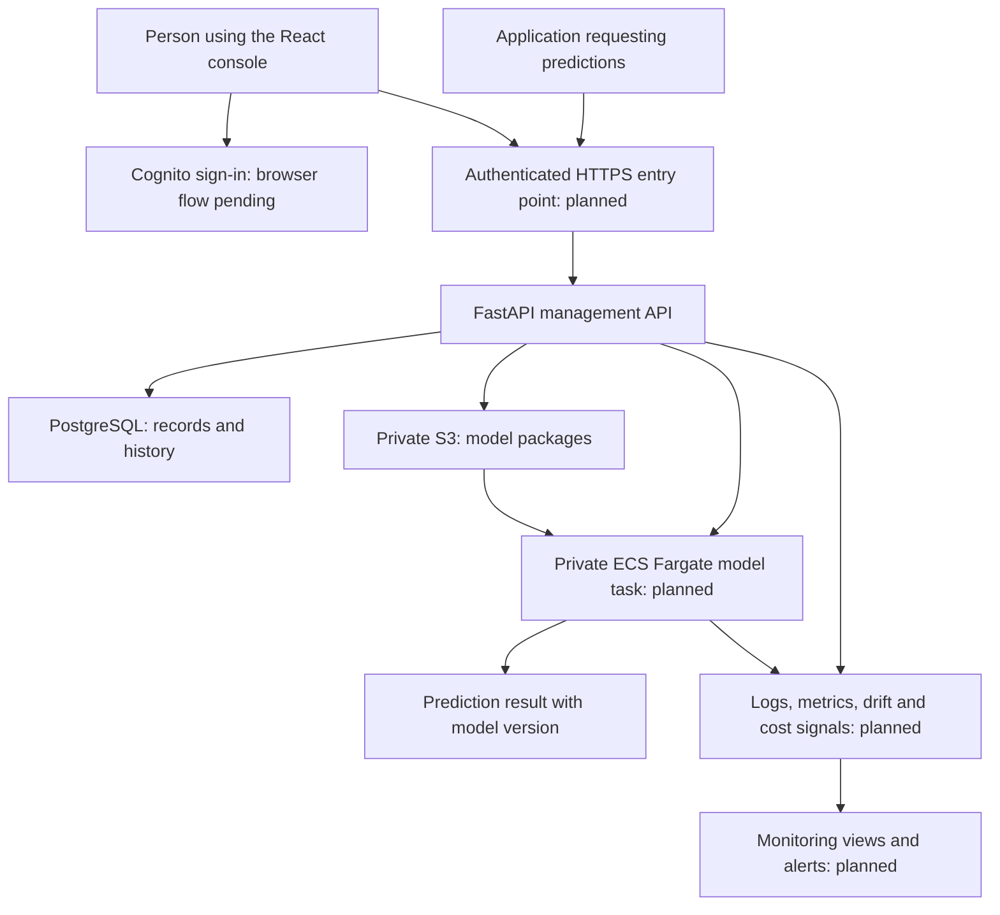

# MessQry AI — the project explained

**Draft · 19 October 2026**

An explanation for founders, collaborators, interviewers, and developers. Read Sections 1–4 for the story, Sections 5–10 for the engineering, and Sections 11–15 for delivery decisions and talking points.

This document describes the repository as inspected on this date, including uncommitted work. It is not a production certification. The live implementation and roadmap may change after this snapshot.

## 1. The project in one minute

MessQry AI helps a team take a machine-learning model from a developer's experiment toward a reliable production service.

A model is a program that has learned patterns from data. For example, a demand model predicts how many products a shop will sell. Training that model is only the beginning: someone must store the correct file, know which version is running, give applications a secure way to request predictions, measure reliability, and recover when an update goes wrong.

MessQry AI brings those operations into one web console and API. Its intended lifecycle is:

**Register a model → upload a version → evaluate it → deploy it → serve predictions → observe behavior → promote or roll back versions.**

Later, approved automation could add retraining and repeat this lifecycle. Automated retraining is a long-term goal, outside the first production release.

The first release targets **one organization in an isolated AWS deployment**, with one documented model format and one AWS region. Shared multi-tenant SaaS, billing, and autonomous model updates are future work.

### What can we honestly demonstrate today?

We can demonstrate a local web console, model registration and search, validated model-package upload, version inspection, private-storage interfaces, registry token checks, database-backed deployment selections/history, and recorded metric comparisons.

We cannot yet demonstrate a complete production prediction service. The scoped prediction endpoint now resolves the selected validated version and uses a bounded HTTP adapter plus a mock-tested ECS warm-task cache, health check, and idle timer. The runtime image, package loading, actual task launch, VPC/IAM controls, benchmark evaluations, and inference telemetry are not implemented or cloud-verified. Browser sign-in and cloud provisioning are also pending; automated retraining remains a later-phase goal.

## 2. The problem and why it matters

Imagine a team with a demand-prediction model:

1. A data scientist produces `model-final.pkl`.
2. Another person creates `model-final-new.pkl`.
3. A developer exposes one file through an application server.
4. Nobody can confidently connect the running service to its training result.
5. A new model is slower or makes worse predictions, but the team notices only after users complain.
6. Restoring the previous model becomes a manual search through files and deployment scripts.

The problem is the missing operational system around the model. This is what **MLOps**, or machine-learning operations, addresses.

| Team problem | MessQry's response | Status |
| --- | --- | --- |
| Files and versions are difficult to trace | Named model records, numbered versions, package checksums, stored metadata | Implemented locally |
| Uploaded files have inconsistent structure | One supported MLflow `pyfunc` package contract and structural validation | Implemented |
| Model files need controlled access | Private storage adapter and scoped registry API access | Code implemented; live AWS integration unverified |
| Nobody knows which version an environment selects | Deployment selection and change history | Implemented as database state |
| A bad update needs a recovery path | Version selection rollback; later, runtime rollback | Selection rollback implemented; runtime rollback planned |
| Quality decisions are informal | Recorded thresholds; reproducible evaluations and production promotion gates | Basic comparisons and production policy gating implemented; reproducible metric execution remains planned |
| Slow or unreliable inference goes unnoticed | Runtime health, latency, errors, drift, alerts, and costs | Planned |
| Each team assembles disconnected tools | A web console and consistent API for lifecycle operations | Console foundation and registry implemented |

The intended benefit is less manual deployment work, better traceability, faster diagnosis, and safer releases. These are product goals; the repository does not yet establish measured business savings or production reliability.

## 3. The core concepts, without jargon

| Term | Meaning in this project |
| --- | --- |
| Model | The named project, such as `demand-forecast`. |
| Model version | A particular registered package, such as version 3. Updating a model means registering another version. |
| Artifact | The actual saved model package and its supporting files. |
| Metadata | Information about a model: name, version, checksum, framework, timestamps, and storage reference. |
| Registry | The catalog connecting model names, versions, and artifact information. |
| Environment | A destination label such as `staging` or `production`. |
| Deployment | The model version selected for a model/environment pair; eventually also its running serving workload. |
| Inference / prediction | Running an already trained model on new input to get an answer. |
| Evaluation | Checking model results against a quality rule, ideally using a reproducible dataset. |
| Promotion | Moving an environment to a selected version. This changes a database selection today; runtime replacement comes later. |
| Rollback | Selecting an earlier known version after a problematic update. The current API accepts a different registered version; it does not prove that version was previously healthy or deployed. |
| Drift | A change in incoming data patterns compared with a reference. Drift can indicate risk, but does not by itself prove prediction accuracy has fallen. |
| Control plane | The management service: records, permissions, version decisions, and deployment intent. |
| Model runtime / data plane | The separate process that loads model code and answers prediction requests. |

## 4. How the full system is intended to work

The following diagram is the **target flow**. Some boxes already exist as local code; the runtime, production edge, and telemetry connections are planned.



### Step A — develop and train a model

A data scientist initially trains a model outside MessQry, using their own training environment. Scikit-learn, PyTorch, or TensorFlow might produce the underlying model, but none is currently selected as a required platform dependency.

The supported handoff is an **MLflow `pyfunc` model directory**, transported as a ZIP. This gives different Python models a common prediction interface. Supporting that interface does not mean every model, dependency, GPU workload, or dataset shape will automatically work.

### Step B — register and upload

The user creates a named model in the console and uploads a ZIP for a new version. The browser sends a multipart form, which is the usual HTTP format for uploading a file together with text fields.

The API checks registry permissions, verifies that the named model exists, inspects the package, calculates its SHA-256 checksum, and stores it using a server-generated key. It then records the next version in the database. If database registration fails after storage succeeds, it attempts to remove the unregistered object.

The database and object store are separate systems, so this cleanup is a compensating action, not one transaction covering both systems. Handling every crash window and orphaned object remains an operational concern.

### Step C — check quality

Today an authorized caller creates an immutable, versioned threshold policy for a model and environment, then submits numeric metrics with a selected policy ID. The API compares the metrics to the stored rules and records a pass/fail result. For example, supplied accuracy `0.94` meets a stored minimum of `0.90`.

The API does not currently calculate that accuracy, run a benchmark dataset, or establish that the supplied result is trustworthy. Dataset/evaluator provenance and immutable policy versions are recorded, but dataset checksums remain caller-declared. Production version changes require current passing policy evaluations unless a caller with the separate override scope records a reason; reproducible metric execution and evaluation UI remain Phase 4 work.

### Step D — choose an environment and deploy

Deployment controls store which registered version an environment selects and write a history event. On prediction, the API starts or reuses a private runtime task for that deployment revision and checks health before forwarding input. No model server image is included yet, so actual inference is not available.

The selected runtime direction is one isolated **ECS Fargate task per model/environment deployment**. The future deployment adapter must start the right workload, wait for health, discover its private address, and only then route requests to it. Failed startup and replacement behavior still need implementation.

### Step E — request predictions

A business application will send structured input to an authenticated prediction endpoint. The API resolves the deployment's selected version and forwards bounded input to its private runtime. That runtime loads the package, applies the model, and returns predictions. The API returns the model version alongside the answer.

The console is primarily the management interface. Applications consuming predictions can call the API directly without a person keeping the console open.

### Step F — observe and recover

Planned monitoring will connect each signal to the relevant deployment and version. Operators should see request volume, latency, failures, health, data-quality/drift signals, and resource/cost information. Alerts should point to an actionable condition.

Promotion and rollback must eventually update both recorded intent and actual runtime traffic safely. Future retraining would produce a new candidate version and pass through evaluation and approval rules again.

## 5. Frontend: what runs in the browser

| Technology | Plain-English job | Where and how we use it |
| --- | --- | --- |
| React 19 | Builds the interactive web interface from reusable pieces | `frontend/src/App.tsx` contains the console shell, navigation, Overview, and shared presentation; `ModelsPage.tsx` implements registry workflows. |
| React DOM | Places React's interface into the browser page | `frontend/src/main.tsx` starts the application. |
| TypeScript | Checks expected data shapes before shipping the interface | Components, API functions, and `types.ts` describe model, version, deployment, and evaluation records. Type checking is not runtime validation of a server response. |
| Vite 8 and its React plugin | Runs the development server and builds production frontend assets | `vite.config.ts` enables React and proxies local API requests to FastAPI on port 8000. The usual local browser address is port 5173. |
| Tailwind CSS 4 and its Vite plugin | Provide the configured styling foundation | Integrated through Vite; project CSS in `styles.css` defines the actual surfaces, layout, spacing, responsive behavior, and visual states. |
| CSS Grid, media queries, and normal CSS | Align panels and adapt the interface to different screens | The shared grid and mobile layout support desktop and narrow screens. |
| Lucide React | Supplies consistent vector icons | Navigation and operational UI use components from `lucide-react`, rather than emoji as interface icons. |
| Browser Fetch API | Sends HTTP requests to the backend | `api.ts` reads records, creates models, and submits artifact uploads. No Axios dependency is required. |
| JSON and FormData | Carry ordinary records and file uploads | JSON is used for data; FormData packages the ZIP and optional framework field. |
| npm and `package-lock.json` | Install frontend dependencies consistently | `npm ci` uses the committed lockfile; Node.js runs the development/build tools, not the Python backend. |

React state tracks the active screen, drawer state, forms, loading, and feedback. The inspected frontend does not use Redux, a client query library, or a dedicated routing library. Overview aggregates several API calls; large registries will need more efficient querying and pagination as the product grows.

### Screen responsibilities

| Screen | Purpose | Snapshot status |
| --- | --- | --- |
| Overview | Show real registry/deployment/evaluation summaries and recent activity | Implemented; missing telemetry is shown as unavailable. |
| Models | Search/register models, upload packages, inspect versions and validation metadata | Implemented locally. |
| Deployments | Select versions, promote/roll back, inspect environment health and history | Navigation exists; full workflow planned in Phase 3. |
| Evaluations | Inspect datasets, metrics, comparisons, and promotion eligibility | Full workflow planned in Phase 4. |
| Monitoring | Inspect latency, errors, drift, costs, alerts, and stale data | Planned in Phase 5. |
| Settings | Present relevant workspace and operational configuration | Navigation exists; full workflow is not complete. |

The approved visual direction is a dark charcoal workspace with restrained orange branding, neutral surfaces, semantic status colors, clear column alignment, sans-serif interface text, and monospace technical details. Keyboard focus, mobile navigation, reduced motion, and readable feedback are part of the design direction. Orange is an action/brand color, not the meaning of every status.

`VITE_API_BASE_URL` selects the backend address. `VITE_DEPLOYMENT_ENV` labels the actual API environment independently of Vite's build mode. Frontend build variables are public: they cannot safely hold credentials.

Browser sign-in is pending. The current Fetch functions do not attach Cognito access tokens; the local console works through the development bypass. Production browser access requires that integration.

## 6. Backend: the management service

| Technology | Plain-English job | Where and how we use it |
| --- | --- | --- |
| Python 3.11+ | The language for the backend and model-facing work | All `src/messqry` modules. It matches the chosen Python model interface. |
| FastAPI | Defines the API's available operations and connects validation, dependencies, and responses | Registry routes, deployment selections, evaluations, health checks, and application setup. |
| Uvicorn with standard extras | Runs the Python application and accepts HTTP connections | Local startup uses `uvicorn messqry.main:app --reload --app-dir src`. Production process settings remain delivery work. |
| ASGI, Starlette, and AnyIO | Provide the request/response and asynchronous foundations underneath FastAPI | Middleware, streaming responses, HTTP errors, lifecycle handling, and framework concurrency support. Starlette is a framework dependency; AnyIO is explicitly declared. |
| Pydantic | Checks request fields and describes response data | `api/schemas.py`: model names, UUIDs, versions, finite metric values, thresholds, and prediction contracts. |
| pydantic-settings | Loads and validates environment-specific configuration | `config.py` reads `MESSQRY_` settings and rejects several unsafe staging/production combinations. |
| SQLAlchemy 2 | Connects Python objects and queries to database tables | `models.py`, `db.py`, and database operations in route modules. |
| python-multipart | Parses browser file-upload forms | The artifact upload route accepts `UploadFile` and a framework form field. |
| PyYAML | Reads package metadata without importing model code | The validator uses safe YAML loading for the root `MLmodel` file. |
| Python standard library | Handles archive inspection, integrity, identifiers, paths, logging, and timestamps | `zipfile`, `hashlib` SHA-256, `uuid`, `pathlib`, UTC date handling, and related utilities. |
| setuptools, pip, and virtual environments | Package the Python project and isolate its dependencies | `pyproject.toml` defines install requirements and optional extras; `.venv` isolates local packages. |

FastAPI is the application framework; Uvicorn is the process that serves it. React is a separate browser application. These tools have different jobs even though users experience one product.

### API responsibilities

- `/api/v1/models`: create/list models and retrieve model details.
- `/api/v1/models/{model_id}/versions`: register legacy metadata or list versions.
- `/api/v1/models/{model_id}/versions/artifact`: upload and validate an artifact.
- `/api/v1/models/{model_id}/versions/{version_number}/artifact`: download a validated artifact after authorization.
- Version `/evaluations` routes: store and list numeric threshold comparisons.
- Model `/deployments` routes: select environment versions, list selections, roll back selections, and view history.
- `/health`: establish that the API process responds.
- `/ready`: establish that the database can answer a simple query. It does not yet check runtime availability, S3, or inference quality.

FastAPI generates an OpenAPI description and interactive API documentation when enabled. Production settings disable the interactive docs. The API uses `/api/v1` for compatibility and a common error envelope such as `{ "error": { "code": "not_found", "message": "Model not found" } }`.

List endpoints currently return unpaginated arrays. The documented future pagination contract uses a versioned endpoint, bounded page sizes, and opaque cursors so existing clients are not silently broken.

Application lifespan setup creates the storage adapter; shutdown closes its client where supported and disposes database connections. This provides a place to acquire and release service resources.

## 7. Data: why we use both a database and object storage

Think of the database as a library catalog and object storage as the shelves holding the books. The catalog tells us which version exists and where its package belongs; the package contains the actual saved model.

| Component | Role | Current position |
| --- | --- | --- |
| SQLite | A small local database stored in a file | Default for development and disposable tests. |
| PostgreSQL | The selected database for staging/production metadata and concurrent operations | Required by shared-environment settings; production operation unverified. |
| psycopg 3 | The driver SQLAlchemy uses to speak to PostgreSQL | Optional `[postgres]` dependency; URL begins `postgresql+psycopg://`. |
| Alembic | Version-controls changes to database structure | Migrations 0001–0009 introduce the registry, deployment history, evaluations, deployment revision, artifact metadata, deployment idempotency, evaluation provenance, and versioned evaluation policies. |
| Local filesystem adapter | Stores artifacts without an AWS account during development | Implemented under the ignored local artifacts directory. |
| Amazon S3 adapter | Stores model ZIPs in private cloud object storage | Implemented in code using optional `[aws]` dependencies; actual bucket integration unverified. |
| Boto3 | The Python AWS SDK used for S3 operations | Upload, open/download, and cleanup/delete operations. |

The main database entities are:

1. **RegisteredModel:** ID, unique name, description, and creation time.
2. **ModelVersion:** parent model, version number, package reference, SHA-256, size, optional S3 object version, manifest, validation status, framework, metrics, and creation time.
3. **Deployment:** model/environment selection, selected version, update time, and a revision used for concurrency control.
4. **DeploymentEvent:** deployment, previous/next version IDs, action, reason, and time.
5. **ModelEvaluation:** model version, supplied metrics and thresholds, pass/fail, and time.

The current event history is useful, but is not a completed security audit system: user attribution, override audit policy, and comprehensive immutability enforcement need further work.

### Integrity and simultaneous updates

Database uniqueness rules stop duplicate model names and duplicate version numbers for a model. Deployment changes use row locking where supported and an optimistic revision counter: if another request changes the same deployment first, a stale change fails with a conflict rather than silently replacing it.

Version metadata has ORM update/delete guards. This protects ordinary application operations; it is not a guarantee against direct SQL or every bulk operation. Stronger production access controls remain necessary.

Local artifact writes refuse to overwrite an existing file and check byte count and checksum during copying. S3 writes include checksum information, AES-256 server-side encryption, and a create-only condition. S3 object version IDs are stored when available. Bucket versioning, public-access blocking, retention, and policies still require infrastructure configuration. Object versioning alone does not make storage tamper-proof.

Database migrations are controlled release steps, not model retraining. Production migration recovery requires verified backups and rehearsed procedures; those are not yet established here.

## 8. MLflow and package validation

**MLflow's current role is the selected package/interface standard.** We do not currently run an MLflow tracking server or use its hosted registry. The platform's registry is our FastAPI/SQLAlchemy implementation. MLflow itself is not installed as a control-API dependency in `pyproject.toml`.

A valid upload contains a root `MLmodel` file with a `flavors.python_function` section and referenced supporting files. The validator checks structure and metadata, referenced paths, archive integrity, and service limits. It does not load the model.

| Initial limit/check | Purpose |
| --- | --- |
| 512 MiB compressed ZIP | Bound the model-package upload size. |
| 513 MiB total multipart request | Allow the ZIP plus bounded form overhead before parsing. |
| 2 GiB declared expanded content | Limit archive expansion. |
| 10,000 entries | Limit archive complexity. |
| 200:1 maximum per-entry compression ratio | Reject exceptionally compressed entries that may exhaust resources. |
| Stored or deflated ZIP entries only | Restrict supported archive formats. |
| No encrypted entries, links, special files, unsafe paths, duplicate normalized paths, or file/parent collisions | Reduce ambiguity and unsafe filesystem behavior. |
| Referenced files must exist; entry reads verify CRCs | Detect missing content and corrupt archives. |
| SHA-256 of the original ZIP | Give the stored bytes a stable integrity fingerprint. |

These are implementation defaults, not approved or load-tested production capacity promises. A SHA-256 checksum identifies bytes; it does not prove a model is useful, benign, or trained correctly. Safe YAML parsing and ZIP inspection also do not establish that code inside a model is safe to execute.

The previous review identified an outstanding middleware issue: streamed uploads without an oversized `Content-Length` can hit the byte cap but receive a generic 400 because FastAPI catches the custom exception, rather than the intended 413. The byte-counting guard exists; full HTTP behavior needs correction and integration coverage.

Legacy metadata-only versions remain `legacy_unverified`; they cannot be downloaded through the validated-artifact route. A string pointing to a model file is not treated as proof that the platform inspected it.

## 9. Identity, access, and secrets

| Technology/concept | Plain-English meaning | Project use |
| --- | --- | --- |
| Amazon Cognito User Pools | The selected identity service for users and machine clients | Token verification exists for registry APIs; user pool provisioning and browser login remain pending. |
| OIDC-compatible identity | A standard way to integrate login with an identity provider | Architecture direction; Cognito is the selected provider. |
| JWT access token | A signed credential sent with API calls | Registry requests use bearer tokens. The API verifies signature and required claims. |
| JWKS | The identity provider's published public verification keys | PyJWT's key client retrieves Cognito keys to check signatures. These are public keys, not account passwords. |
| PyJWT with cryptography support | The library that verifies tokens | Checks include RS256, issuer, expiry, access-token type, and allowed client IDs. |
| Scopes | Permissions carried by an access token | `messqry/registry.read` and `messqry/registry.write` protect their corresponding registry operations. |
| IAM workload roles | AWS permissions assigned to running software | Intended for API/runtime access to S3 without committed static AWS keys. |
| Secret settings and managed secret delivery | Keep sensitive configuration out of source control and public bundles | Database URL is a secret setting; production secret manager and rotation details remain to be selected and provisioned. |

Human login and service credentials are distinct: a person signs in through the browser; another backend can obtain a machine access token with limited permissions. Neither should receive unrestricted platform access simply because it can authenticate.

Development has an explicit local registry bypass. Settings reject that bypass outside development. Staging/production also require PostgreSQL, S3 configuration, and identity configuration. Requiring configuration does not verify that those services exist or are reachable.

Deployment and evaluation APIs require distinct workspace-wide scopes. Prediction also requires its own scope; registry permissions do not grant inference access. Per-model/environment authorization and actor-aware audit records remain outstanding work.

The first release has no shared-tenant isolation. One organization's deployment must not be advertised as a multi-tenant SaaS security boundary.

## 10. Docker, ECS, and Fargate: where models will run

### What each term means

- **Docker/container image:** a packaged application filesystem and runtime instructions, including the serving code and required dependencies. Reproducible, scanned images are planned; this repository does not yet include their delivery implementation.
- **Amazon ECS:** the AWS service that manages container workloads.
- **AWS Fargate:** the selected compute option that runs ECS tasks without the team managing individual virtual-machine hosts.
- **Task definition:** the workload recipe, including image, resource allocation, command, networking, roles, and logging.
- **Task:** a running instance of that recipe. A task can contain one or more containers; the precise container layout is not yet defined.

### What “task per deployment” means here

A deployment is identified by **model plus environment**. For example:

| Logical deployment | Selected package | Intended baseline runtime |
| --- | --- | --- |
| `demand-forecast / staging` | Version 4 | Its own Fargate task |
| `demand-forecast / production` | Version 3 | A separate Fargate task |
| `fraud-risk / production` | Version 7 | Another separate Fargate task |

This means separate model deployments have separate runtime resource boundaries. It does **not** mean launching a task for every prediction, running a task for every historical model version, or putting every model into the management API's Python process.

Historical versions stay in storage until selected. A production version change should replace the runtime serving that deployment, with health checks and safe routing behavior. Temporary old/new task overlap, traffic switching, and replacement strategy are not yet decided.

### Why this boundary was selected

Model loading may execute uploaded Python code or deserialize objects. A broken, slow, or memory-hungry model should have its own resource boundary instead of taking down the management service. A task receives only the selected package and narrowly scoped permissions.

Isolation still depends on the actual configuration. Fargate does not automatically make arbitrary model code harmless. Nonprivileged execution, limited IAM, bounded CPU/memory/storage, and controlled network access all need implementation.

### Resource and scaling decisions still open

The team must define CPU, memory, ephemeral storage, startup timeout, prediction timeout, maximum request bytes, model dependency policy, network egress, private endpoint discovery, and replacement/health rules.

One baseline task per deployment also leaves an availability question: one task provides no simultaneous second replica. Additional replicas, autoscaling, ECS service supervision versus standalone task management, restart behavior, and any revision to the baseline need explicit decisions. The selected architecture permits further scaling work; automatic scaling is not implemented or proven.

Idle deployments can still consume compute. Small development and production portfolios may have different economics. Scheduling, minimum replicas, scale-to-zero behavior, and per-deployment budgets have not been selected.

The Fargate decision currently covers **model runtimes**. It does not establish where the control API or static frontend will be hosted.

### Planned prediction contract

The proposed route is `POST /api/v1/models/{model_id}/deployments/{environment}/predict`.

```json
{
  "inputs": [
    {"feature_a": 1.2, "feature_b": "north"},
    {"feature_a": 0.7, "feature_b": "south"}
  ]
}
```

The implemented request schema allows 1–1,000 records with the same 1–256 field names, each name up to 128 characters and nonblank. Values may be JSON scalars, arrays, or objects. Row/field counts do not replace a total byte or nesting limit. Runtime conversion and model-signature checks remain implementation work.

The intended result identifies the version that answered:

```json
{
  "model_id": "11111111-1111-4111-8111-111111111111",
  "environment": "production",
  "model_version": 3,
  "predictions": [0.91, 0.12]
}
```

There must be one prediction per input record. The API route requires `messqry/prediction.invoke`, caps request and runtime response bodies at 1 MiB, applies a 30-second runtime timeout, and checks the response's model/environment/version and output count. Its private task cache is keyed by deployment revision and stops idle tasks after five minutes. These controls have mocked local tests; the runtime image, actual AWS networking/task behavior, and live model inference remain unverified.

## 11. Monitoring, evaluation, and retraining

These are related but different jobs:

| Capability | What it answers | Planned implementation needs |
| --- | --- | --- |
| Operational monitoring | Is the service available, fast, and error-free? | Request counts, error rate, latency distributions, task/resource health, correlated logs. |
| Model-quality evaluation | Are predictions good against known answers? | Versioned benchmark data, evaluator version, metric definitions, provenance, thresholds. |
| Data-quality/drift monitoring | Has incoming data become unusual or invalid? | Approved reference data, feature checks, drift method and thresholds, retention/privacy rules. |
| Cost monitoring | What does each deployment consume or cost? | Resource attribution, rate assumptions, measured usage and reconciliation with actual billing. |
| Alerting | When must someone act? | Conditions, delivery channel, deduplication, recovery behavior, and ownership. |
| Retraining | Should we produce a new candidate model? | Approved triggers/data, isolated training jobs, reproducible outputs, evaluation and promotion policy. |

Latency means time spent handling a request; percentiles such as p95 help reveal slow experiences that an average can hide. Model accuracy may require labels that arrive much later than the request. A drift chart cannot substitute for measured accuracy.

Monitoring dashboards must show source, units, time range, and stale/missing states. Missing measurements must not be presented as zero or synthetic “live” figures.

No telemetry backend, drift library, alert delivery product, training orchestrator, or billing-data integration has been finalized. CloudWatch, OpenTelemetry, Prometheus, Grafana, SageMaker, EventBridge, or Step Functions must not be described as installed parts of this project merely because they could serve those roles.

## 12. Testing, delivery, and environments

| Tool/process | Purpose | What exists |
| --- | --- | --- |
| pytest | Backend behavior and regression checks | Registry, storage, package validation, identity, migrations, deployments, errors, configuration, and serving-schema tests. |
| Ruff | Python lint and formatting checks | Configured rules and CI commands. |
| pip-audit | Checks Python dependencies against known vulnerability reports | Included in development dependencies and CI. |
| TypeScript compiler | Checks frontend types | `npm run lint` currently runs `tsc --noEmit`; it is not a separate ESLint ruleset. |
| Vitest | Runs frontend tests | Configured through Vite. |
| React Testing Library, user-event, jest-dom | Render components, simulate interactions, and assert UI behavior | Used for console/registry and accessibility-related regression cases. |
| jsdom | Simulates a browser document during tests | Useful for component tests; it does not replace real-browser inspection. |
| npm audit | Checks frontend dependency vulnerability reports | Configured in CI. |
| Git and GitHub | Track changes and support collaborative review | Repository source and commit history. |
| GitHub Actions | Runs automated checks on pushes and pull requests | Ubuntu backend/frontend jobs; Python 3.11 and Node 22 in the current workflow. |

The backend CI installs dependencies, runs pytest, Ruff checks, and a Python dependency audit. Frontend CI uses `npm ci`, type checking, tests, a production build, and npm audit. This is **continuous integration**, not an implemented AWS deployment pipeline.

Some Windows async/TestClient checks have documented limitations. Many backend tests invoke route functions directly; those do not establish complete HTTP parsing and middleware behavior. Prior recorded results are evidence for those runs only. This explainer was prepared by source inspection, without rerunning checks.

### Environment flow

- **Local development:** React/Vite, FastAPI/Uvicorn, SQLite, local artifacts, explicit development auth bypass.
- **Automated tests:** disposable fixtures/databases and mocks; production services must not be used as test fixtures.
- **Staging, planned:** a separate AWS environment for cloud integration, deployment, and recovery exercises.
- **Production, planned:** an isolated organization deployment with PostgreSQL, private S3, Cognito, controlled runtime execution, secrets, backups, and operational monitoring.

Phase 6 must add infrastructure as code, pinned/scanned container builds, managed secrets, backup/recovery controls, and delivery ordering. A controlled release must handle migrations, application/runtime compatibility, health gates, and rollback artifacts. Frontend delivery also needs safe caching and browser security headers.

## 13. Decisions taken, defaults, and decisions still needed

For a beginner-friendly explanation of AWS compute, database hosting,
networking, roles, and the terms used in this repository, see the
[AWS glossary](AWS_GLOSSARY.md). In particular, PostgreSQL is the selected
database engine for shared environments, but Amazon RDS is only a recommended
hosting option; it has not been selected or provisioned. ECS/Fargate is the
selected way to run isolated model containers, while the API's own hosting
service remains undecided.

### Selected direction or implemented choices

| Choice | Why / consequence |
| --- | --- |
| One organization, one isolated deployment for the first release | Keeps the initial security and operational scope manageable; shared-tenant SaaS is deferred. |
| React + TypeScript + Vite, with Tailwind and project CSS | Provides the implemented responsive management console and typed browser code. |
| Python + FastAPI | Provides the management API and a Python-friendly integration boundary. |
| PostgreSQL for shared environments; SQLite locally | Separates production metadata needs from simple developer setup. |
| SQLAlchemy + Alembic | Provides database access and versioned schema changes. |
| MLflow `pyfunc` ZIP contract | Defines a supported package handoff without executing models in the API. |
| Private S3 with workload IAM | Stores packages separately from metadata and avoids embedded static credentials. |
| Cognito User Pools | Selects the identity provider; registry verification code already exists. |
| ECS Fargate task per model/environment deployment | Selects a separate execution boundary for each model deployment. |
| Manual controlled lifecycle before autonomous retraining | Makes traceability, evaluation, and recovery prerequisites for broader automation. |
| Explicit API versioning and honest unavailable UI states | Protects clients and prevents the console from implying unsupported capabilities. |

### Open decisions — do not present these as commitments

| Area | What still needs deciding |
| --- | --- |
| Runtime profile | CPU/memory/storage, image contents, dependency policy, startup/request timeouts, byte limits, networking, discovery, and replacement strategy. |
| Availability and scaling | Replicas, supervision, autoscaling policy, health gates, traffic switching, recovery behavior, and budget trade-offs. |
| AWS foundation | Region, VPC/network layout, HTTPS edge/routing, API hosting, frontend hosting, DNS/certificates, and image registry. |
| Database hosting | Managed PostgreSQL service and sizing, encryption, connection limits, backup/restore design. Amazon RDS has not been established as a repository decision. |
| Infrastructure tooling | Terraform, AWS CDK, or another tool; none is selected in the inspected files. |
| Identity integration | Pool/app client/resource-server values, browser callbacks/login/session flow, full permission mapping, and credential rotation. |
| Encryption and secrets | KMS policy where needed, managed secret provider, rotation, and least-privilege deployment roles. |
| Evaluations | Dataset ownership/versioning, evaluator version, metric direction, freshness, thresholds, and authorized overrides. |
| Operations | Telemetry storage, drift method, alert channels, retention, request privacy, and cost attribution/budgets. |
| Recovery targets | Availability objective, recovery point objective (acceptable data loss), and recovery time objective (acceptable restore time). |
| Future SaaS and retraining | Tenant isolation, quotas/billing, training infrastructure, trigger policy, and approval controls. |

For example, ECR could store container images, an ALB could route HTTPS traffic, and CloudWatch could collect AWS signals. These are possible implementations, not tools already adopted by this repository. No Redis, Kubernetes, Next.js, message broker, GPU runtime, or hosted MLflow service is part of the inspected implementation.

## 14. How the phases fit together

| Phase | What it delivers | Frontend role | Snapshot status |
| --- | --- | --- | --- |
| 0 — Audit and stabilization | Baseline, fixes, reproducible setup, initial regression coverage | Record UI direction | Complete in tracker. |
| 1 — Architecture/foundations | Configuration, lifecycle, API conventions, CI and design foundation | Responsive shell and Overview | Complete in tracker. |
| 2 — Registry/artifacts | Version metadata, validation, storage adapters, scoped registry access | Model registration/upload/version inspection | Tasks marked implemented and locally verified; cloud integration remains unverified. |
| 3 — Secure serving/deployments | Isolated runtimes, prediction, deployment permissions and recovery | Deployment controls and sign-in/session states | In progress; scoped prediction route, bounded transport, health check, and process-local warm-task lifecycle are implemented with mock tests; runtime image and AWS execution remain pending. |
| 4 — Evaluation policies | Reproducible evaluation and enforced promotion eligibility | Results, comparisons, provenance and eligibility | Partially implemented: versioned policies and production gating exist; metric computation and evaluation UI remain planned. |
| 5 — Observability | Logs, performance, drift, alerts, retention and cost controls | Operational monitoring views | Planned. |
| 6 — AWS/delivery | Infrastructure, images, secrets, backups and deployment pipeline | Production frontend delivery | Planned. |
| 7 — Release readiness | Security, load, recovery, docs and release approval evidence | Browser/accessibility/performance acceptance | Planned. |

The current tracker reports “2 of 8 phases complete” while also marking all Phase 2 tasks implemented and locally verified. That summary is not fully aligned with its task detail. Use the capability-level status above and the tracker evidence rather than claiming an exact production completion percentage. Equal task counts would not represent equal engineering effort or production readiness anyway.

Backend and frontend work are coordinated throughout the phases; the frontend is not postponed until the backend is finished. Registry UI is Phase 2, deployment/sign-in UI is Phase 3, evaluation UI is Phase 4, and monitoring UI is Phase 5.

## 15. Answers you can use in a conversation

### “Is this an AI model or an AI platform?”

It is a platform for operating models. It manages the lifecycle around a team's model; it is not currently training a proprietary foundation model.

### “Why isn't saving a model file enough?”

A production team also needs to identify the running version, authorize access, check quality, serve requests within resource limits, diagnose failures, and reverse a bad update. Saving the file solves only storage.

### “Why React and Python together?”

React runs the interactive console in the browser. Python/FastAPI runs the backend management service. They exchange JSON and file uploads over HTTP, so each handles its own role.

### “Why PostgreSQL and S3?”

PostgreSQL holds structured records and relationships. S3 holds the larger model packages. A version record connects the two through a controlled storage reference and checksum.

### “Are we using the MLflow registry?”

No. We selected MLflow `pyfunc` as the supported package and prediction interface. The current registry is implemented in our own API/database. A tracking server is not part of the current stack.

### “What exactly is deployed today?”

The API records an environment's selected version and history. The optional, disabled-by-default manager can start a configured Fargate task, verify its model-version health response, forward predictions to its private address, reuse the task while warm, and stop it after idle time. These paths have local mocked coverage, but no runtime image or AWS environment is configured, so they do not yet provide usable live inference.

### “Why a Fargate task for each deployment?”

It separates a model/environment workload from the management API and other model deployments. It gives us a place to enforce workload-specific resources and permissions. We still need to define availability, discovery, scaling, and safe replacement behavior.

### “Can it detect declining model accuracy?”

That is planned. Currently it stores comparisons of submitted metrics. Real quality monitoring needs evaluation data or eventual ground-truth labels; latency and drift alone do not measure accuracy.

### “Does it automatically retrain and promote models?”

No. The first release prioritizes controlled registration, serving, evaluation, and observation. Future retraining should create a candidate version and pass through evaluation and authorized promotion controls.

### “Is it production-ready or multi-tenant?”

No. It has a local foundation with cloud integration code and an explicit production roadmap. Model serving, complete authorization, browser login, live cloud checks, observability, recovery exercises, and release acceptance still need work. Multi-tenant SaaS is a later scope.

### A short project pitch

> MessQry AI is an MLOps platform that helps teams turn saved machine-learning models into traceable, controlled production services. Its React console and Python/FastAPI backend manage model versions, packages, deployment selections, and evaluation records. The selected production architecture uses PostgreSQL for metadata, private S3 for packages, Cognito for identity, and isolated ECS Fargate tasks for model serving. The registry foundation is implemented locally; secure runtime deployment, monitoring, and production delivery are the next stages.

## Repository reading map

These are relative source references within this repository, so the explainer remains portable:

| Question | Start here |
| --- | --- |
| What can be run now? | `README.md` |
| What are the phase tasks and their evidence? | `ROADMAP.md`, `PROGRESS.md` |
| How is the console built? | `frontend/package.json`, `frontend/vite.config.ts`, `frontend/src/App.tsx`, `ModelsPage.tsx`, `api.ts`, `styles.css` |
| Which Python packages are declared? | `pyproject.toml` |
| How does the API start/configure itself? | `src/messqry/main.py`, `config.py`, `db.py` |
| What do we persist? | `src/messqry/models.py`, `migrations/versions/` |
| How do registry, deployment, and evaluation operations work? | `src/messqry/api/routes.py`, `deployments.py`, `evaluations.py`, `schemas.py` |
| How do credentials and permissions work? | `src/messqry/api/security.py`, `.env.example` |
| How are artifacts stored and validated? | `src/messqry/artifact_storage.py`, `package_validation.py`, `api/middleware.py`, `docs/MODEL_PACKAGE.md` |
| What is the planned prediction boundary? | `docs/SERVING_CONTRACT.md` |
| What is the API compatibility policy? | `docs/API.md` |
| Which automated checks run? | `.github/workflows/ci.yml`, `tests/`, `frontend/src/*.test.tsx` |

Maintain this draft when implementation or owner decisions change. In particular, update the current-status claims after serving, sign-in, cloud integration, monitoring, and release checks are actually completed.
